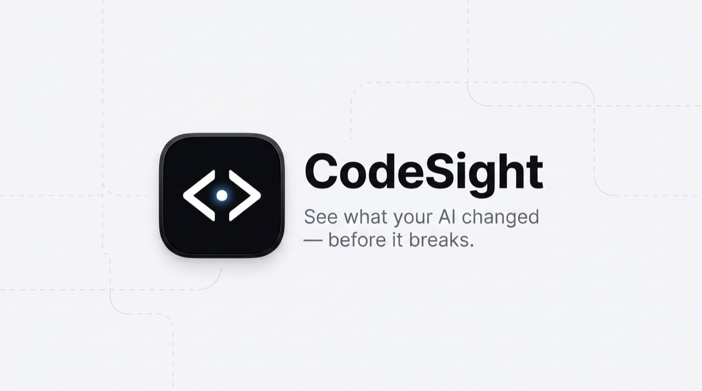
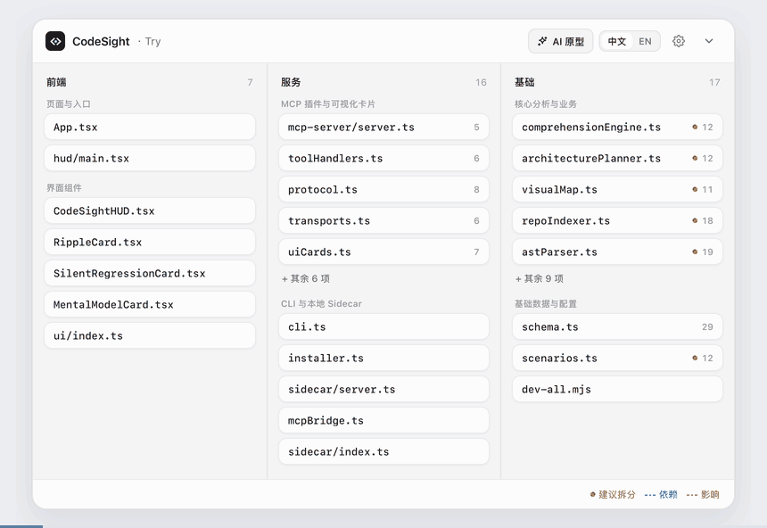
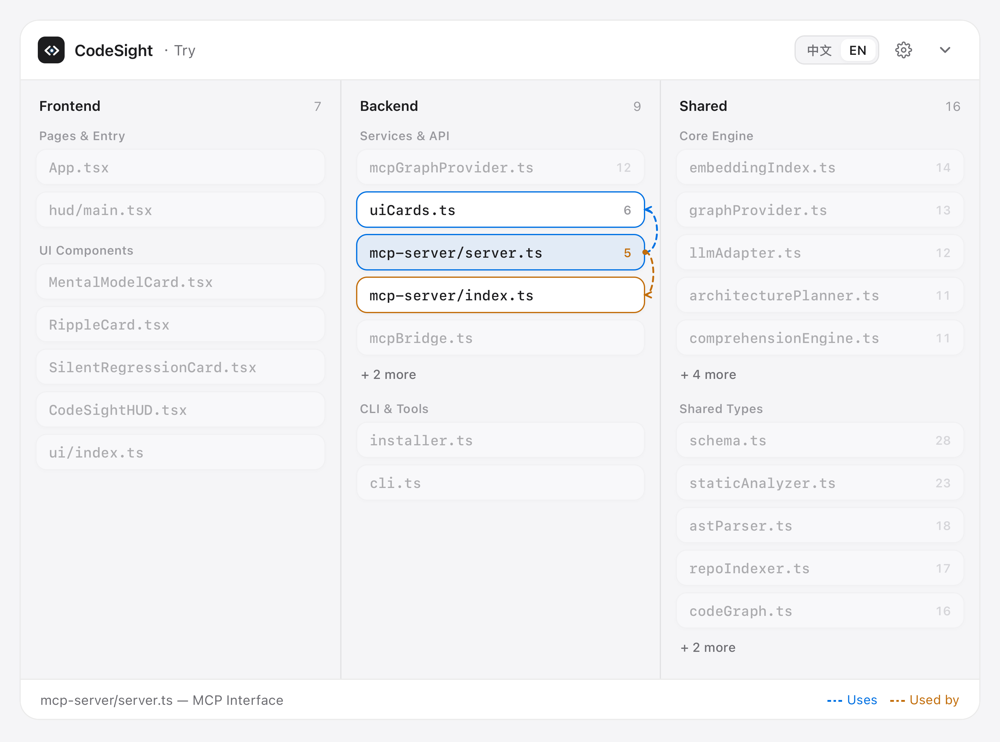
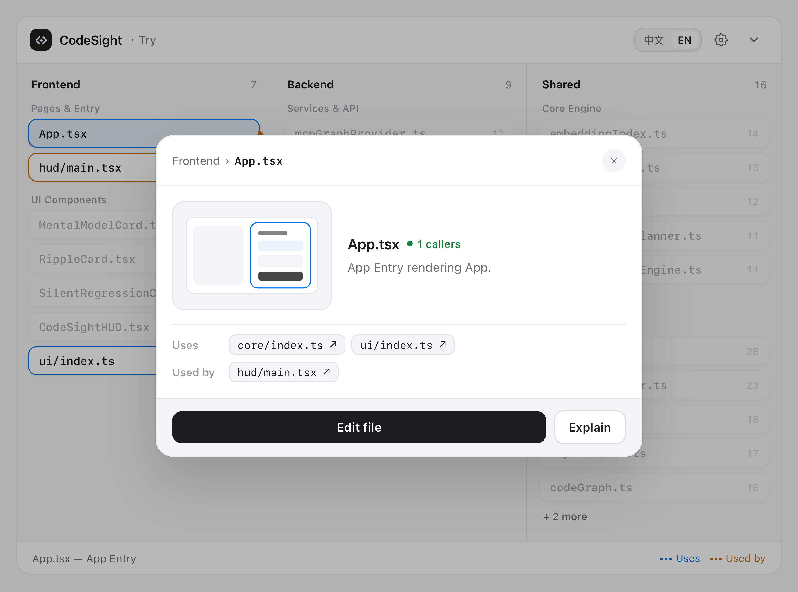
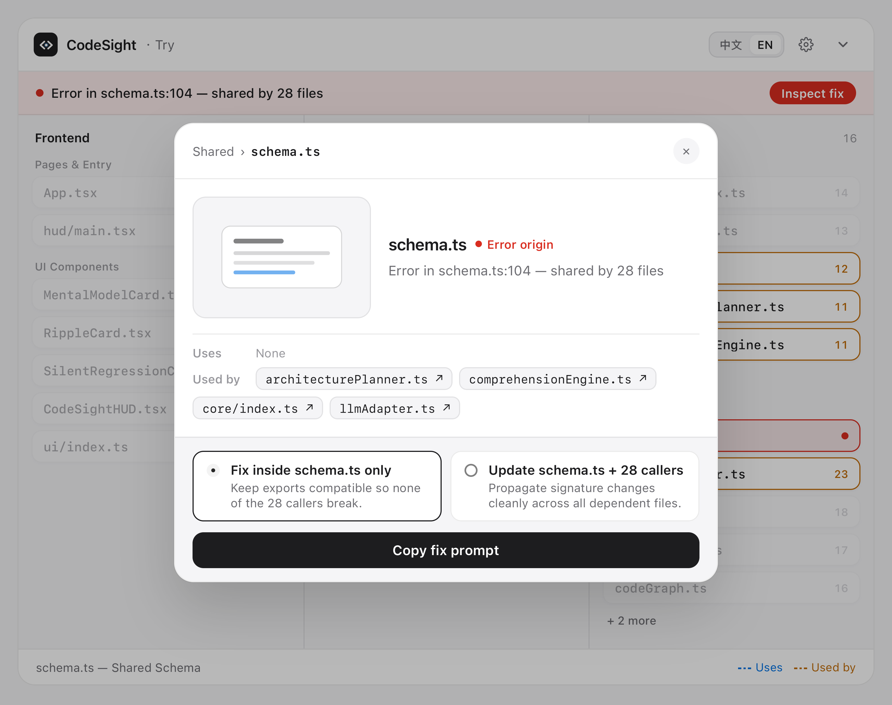
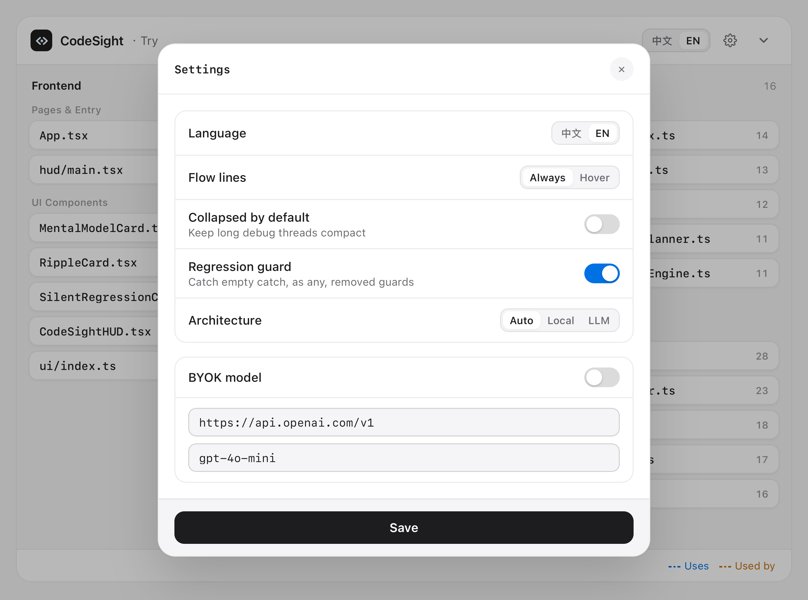
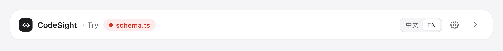
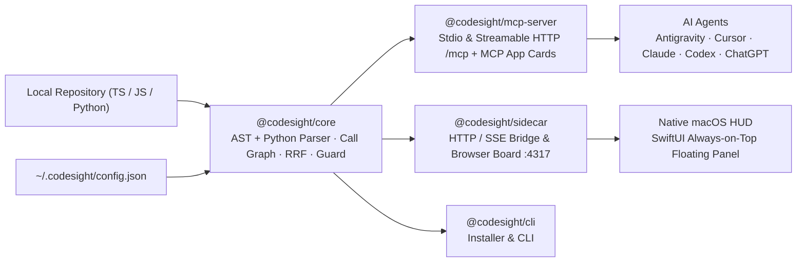

<p align="center">
  
</p>

<p align="center">
  <a href="https://github.com/Rex16200513/codesight/actions/workflows/ci.yml"></a>
  <a href="https://github.com/Rex16200513/codesight/releases"></a>
  <a href="./LICENSE"></a>
  = 18" />
  
  
</p>

<p align="center">
  <strong>English</strong> ·
  <a href="./README.zh-CN.md">简体中文</a> ·
  <a href="https://github.com/Rex16200513/codesight/releases/download/v1.0.1/codesight-promo.mp4">Watch 1080p60 Promo Video</a> ·
  <a href="./CHANGELOG.md">Changelog</a>
</p>

---

**CodeSight** is a local-first **GraphRAG code comprehension and diagnostic engine** for AI-assisted coding.

As AI agents edit across dozens of files, two failure modes appear repeatedly: **losing track of architecture** and **silent regressions** (removing validation guards, swallowing exceptions with empty `catch {}`, or hiding type errors with `as any`). CodeSight builds a deterministic AST call graph and dependency map locally in milliseconds, intercepts silent regressions with **zero LLM tokens**, and renders clean interactive visual cards directly inside your AI agent or as a native macOS Floating HUD.

---

## Live Preview

<p align="center">
  
</p>

<p align="center">
  <sub>Full HD 1080p 60fps launch video: <a href="https://github.com/Rex16200513/codesight/releases/download/v1.0.1/codesight-promo.mp4">Download from GitHub Release v1.0.1</a></sub>
</p>

---

## Who Is CodeSight For?

CodeSight bridges the gap between **visual product thinking** and **precise code-level debugging**:

- **Product Managers, Designers & Non-Technical Builders (Vibe Coders)**
  - Grasp the overall repository structure in seconds without reading raw source code.
  - See **which frontend components control what appears on screen** — click any UI file to preview its inferred wireframe prototype (page, modal, HUD, card) and relationships.
  - Spot **which backend and shared modules are Core hubs** (high downstream usage) so you know what is safe to tweak vs. what needs extra care before prompting an AI agent.
- **Engineers & Full-Stack Developers**
  - Jump straight from a compiler/runtime error or `git diff` to the **exact code block, line range, and cross-file AST callers** involved.
  - Inspect **blast radius** (direct & indirect downstream impact) and **safe zone count** before modifying shared types, schemas, or APIs.
  - Catch **silent regressions** (`as any`, empty `catch {}`, removed auth/validation guards) deterministically with **0 LLM tokens**, and choose between a minimal backward-compatible fix or a coordinated multi-file update.

---

## What CodeSight Does on Top of GraphRAG

Instead of feeding raw chunks of text into an LLM, CodeSight runs a deterministic **5-stage local GraphRAG pipeline** over your repository:

1. **Incremental AST & Multi-Language Parsing** (`astParser.ts`, `repoIndexer.ts`)
   Parses TypeScript / JavaScript / TSX / JSX with the real **TypeScript Compiler API** (eliminating regex false positives) alongside a **Python** relative/dotted import & call parser, with SHA-256 hash caching in `.codesight/index.json` for millisecond incremental updates.
2. **Dual-Layer Graph Construction** (`codeGraph.ts`, `graphProvider.ts`, `mcpGraphProvider.ts`)
   Builds both a **File Dependency Graph** (in-degree, out-degree, transitive downstream reach, Core-hub detection) and a **Cross-File Symbol Call Graph** (exact function, class, and React JSX component callers with line numbers), with pluggable external stdio Graph-RAG MCP support.
3. **Hybrid Retrieval with Reciprocal Rank Fusion** (`embeddingIndex.ts`)
   Combines **Okapi BM25** + **bilingual semantic vectors** + **1-hop graph propagation** (with barrel `index.ts` damping) to surface the exact minimal code slice — typically reducing whole-repo LLM context by **~97%**.
4. **Semantic Architecture & Prototype Abstraction** (`architecturePlanner.ts`, `visualMap.ts`)
   Transforms raw graph nodes into human-readable **Frontend / Backend / Shared** vertical layers, plain-language roles, and auto-inferred **UI wireframe / API flow prototypes** — powered by 0-token heuristics, host-agent `architectureOverride` caching, or optional BYOK LLM planning.
5. **Deterministic Error Projection & Silent Regression Guard** (`staticAnalyzer.ts`, `comprehensionEngine.ts`)
   Strips stack-trace noise, projects errors and `git diff` hunks onto exact AST symbols and blast radius, flags `REMOVED_GUARD` / `SWALLOWED_ERROR` / `TYPE_ESCAPE_HATCH` at **0 tokens**, and generates scoped architectural fix options for your AI agent.

---

## Why CodeSight

| Capability | Raw AI Agent | With CodeSight |
| --- | --- | --- |
| **Understanding an unfamiliar repo** | Burns 25k–60k tokens skimming files | Incremental AST + dependency map in ~25ms (**0 LLM tokens**) |
| **Checking who calls a shared type/fn** | Text grep, often misses re-exports or JSX callers | Deterministic cross-file AST symbol call graph (`codesight_trace`) |
| **Debugging multi-file errors** | Blind trial-and-error loops | Projects stack trace onto dependency graph (**~97% token reduction**) |
| **Catching silent regressions** | Frequently passes build via `as any` or empty `catch` | Instant 0-token diff guard flags `REMOVED_GUARD`, `SWALLOWED_ERROR`, `TYPE_ESCAPE_HATCH` |
| **Human visibility in chat** | Walls of markdown text | Collapsible, bilingual interactive cards with UI wireframes & directional dashed flows |

---

## Product Tour

### 1. Layered Architecture & Directional Flow Lines
Automatically detects **Frontend**, **Backend**, and **Shared / Core** separation across TypeScript, JavaScript, and Python repositories. Hover any file to trace its exact **1-hop dependencies** (blue dashed) and **impacted consumers** (amber/red dashed).

<p align="center">
  
</p>

### 2. UI Wireframes, Non-UI Relation Graphs & 0-Token Split Tips
Click any UI module to preview a **typed mini-Figma wireframe** (header, tabs, toggles, sliders, chips, lists, actions — refreshable on demand via the `AI UI` button), or click any backend/core file to inspect its real **local AST dependency mini-graph**. Oversized or high-impact modules are flagged with a subtle amber dot (`● Large`) and a 1-click **Safe Split** prompt that closes the loop by re-running CodeSight after edits.

<p align="center">
  
</p>

### 3. Error Blast Radius & Guided Fix Directions
When a build or runtime error occurs, CodeSight highlights the fault origin in red, draws impacted downstream links, catches silent regressions, and presents a clean **2-option decision fork** (e.g., *keep exports compatible* vs *cascade update all callers*) before the AI touches shared code.

<p align="center">
  
</p>

### 4. Collapsible Cards & Unified Settings Across Agents and macOS HUD
Built for long debugging threads: click the top bar or chevron to collapse any card into a **44px single-line bar** (with an inline fault badge), or open **`⚙ Settings`** to customize language (`EN` / `中文`), dashed lines, default-collapsed mode, regression guard, and optional BYOK models — persisted to `~/.codesight/config.json` and shared with the native macOS HUD.

<table>
  <tr>
    <td width="52%" valign="top">
      
      <p align="center"><sub>In-card Apple-style Settings synced to <code>~/.codesight/config.json</code></sub></p>
    </td>
    <td width="48%" valign="middle">
      
      <p align="center"><sub>Collapsed 44px single-line bar keeps long chat threads clean</sub></p>
      <br />
      <ul>
        <li><strong>Agent Plugin Settings</strong>: click <code>⚙</code> or call <code>codesight_settings</code></li>
        <li><strong>macOS HUD Settings</strong>: press <code>⌘,</code> for Language, Always on Top, Opacity &amp; Guard</li>
        <li><strong>CLI Settings</strong>: <code>codesight config show | set | reset</code></li>
      </ul>
    </td>
  </tr>
</table>

---

## Ecosystem Compatibility

| Client / Environment | Transport | Interactive Board | Setup Command |
| --- | --- | --- | --- |
| **Antigravity** | Native Plugin + MCP Apps (`stdio`) | Inline Chat Cards | `node packages/cli/dist/cli.js install --target antigravity` |
| **Cursor** | MCP (`stdio`) | Browser Board + Text | `node packages/cli/dist/cli.js install --target cursor` |
| **Claude Code** | MCP (`stdio`) | Browser Board + Text | `node packages/cli/dist/cli.js install --target claude-code` |
| **Claude Desktop** | MCP Apps (`stdio`) | Inline Chat Cards | `node packages/cli/dist/cli.js install --target claude-desktop` |
| **VS Code / Copilot** | MCP (`stdio`) | Browser Board + macOS HUD | `node packages/cli/dist/cli.js install --target vscode` |
| **OpenAI Codex CLI** | MCP (`stdio`) | Browser Board + Text | `node packages/cli/dist/cli.js install --target codex` |
| **ChatGPT Apps / Remote** | Streamable HTTP (`/mcp`) | Inline MCP Apps | `npm run mcp:http` |
| **macOS Floating HUD** | Local Sidecar (`127.0.0.1:4317`) | Native SwiftUI Window | `npm run hud:open` |

---

## Quick Start

### 1. Clone & Build

```bash
git clone https://github.com/Rex16200513/codesight.git
cd codesight
npm install && npm run build
```

### 2. Install Into Your AI Agent

```bash
# Install for a specific agent (add --global for user-wide config, --dry-run to preview)
node packages/cli/dist/cli.js install --target cursor
node packages/cli/dist/cli.js install --target claude-code
node packages/cli/dist/cli.js install --target antigravity

# Or configure all supported agents at once
node packages/cli/dist/cli.js install --target all --dry-run
```

### 3. Open the Interactive Visual Board in Your Browser

```bash
# Generate and open a standalone interactive board for any local repo
node packages/cli/dist/cli.js map --open

# Or run the local Sidecar for live updates + persistent in-card settings (http://127.0.0.1:4317)
npm run dev:sidecar
```

### 4. Optional: Launch the Native macOS Floating HUD (For VS Code / IDE Users)

```bash
npm run hud:open
```

---

## MCP Tools & CLI Reference

| MCP Tool | CLI Equivalent | What It Does |
| --- | --- | --- |
| `codesight_map` | `npm run cs -- map [dir] [--open]` | Incremental AST + dependency map & interactive architecture board |
| `codesight_ask` | `npm run cs -- ask "<query>" [dir]` | Hybrid BM25 + bilingual vector + 1-hop dependency graph RRF search |
| `codesight_trace` | `npm run cs -- trace <symbol> [dir]` | Cross-file AST caller & callee trace for any function, class, or component |
| `codesight_diagnose` | `npm run cs -- diagnose --error "..." \| --git` | Blast radius, safe zone count, silent regression guard, and fix directions |
| `codesight_settings` | `npm run cs -- config [show\|set\|reset]` | Read/write unified preferences in `~/.codesight/config.json` |

### Unified Configuration (`~/.codesight/config.json`)

```bash
npm run cs -- config set language en
npm run cs -- config set dashedLines hover
npm run cs -- config set collapsedByDefault true
npm run cs -- config set silentRegressionGuard true
```

---

## Architecture



```text
assets/            Brand identity (logo.svg, codesight-logo.png, promo video, screenshots)
packages/
  core/            TS Compiler AST & Python parser, dependency/call graph, hybrid RRF, config store
  mcp-server/      Stdio + Streamable HTTP (/mcp) server & Apple-minimalist MCP App cards
  cli/             CLI (map, ask, trace, diagnose, config, install)
  sidecar/         Local HTTP/SSE engine bridge & browser visual board (port 4317)
  ui/              Shared React HUD components
apps/
  macos-hud/       Native Swift 6 + SwiftUI/AppKit floating HUD (arm64 macOS)
plugins/
  codesight/       Antigravity & Claude Code native plugin bundle (SKILL.md + AGENTS.md)
```

---

## Privacy & Local-First Design

- **Zero cloud lock-in**: Indexing, AST parsing, dependency graphs, hybrid search, and silent regression detection run **100% locally** with zero API keys required.
- **Optional BYOK**: Only if you explicitly enable BYOK in Settings (OpenAI, DeepSeek, Gemini via OpenRouter, or local Ollama) are pruned code slices sent to your configured endpoint.
- **Pluggable External Graph-RAG**: Supports attaching external stdio MCP graph servers via `--mcp-cmd` / `CODESIGHT_MCP_GRAPH_CMD`.

## License

[MIT](./LICENSE) © 2026 CodeSight Contributors
