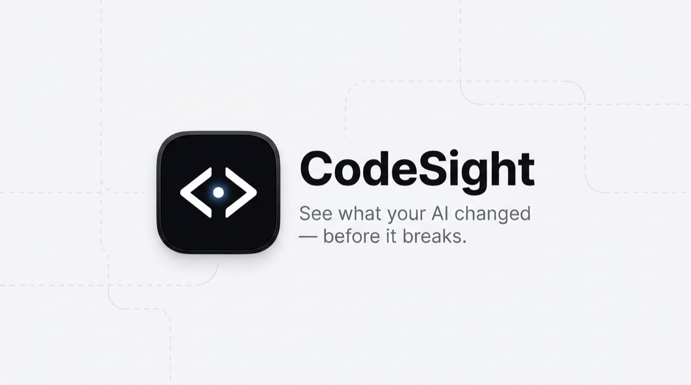
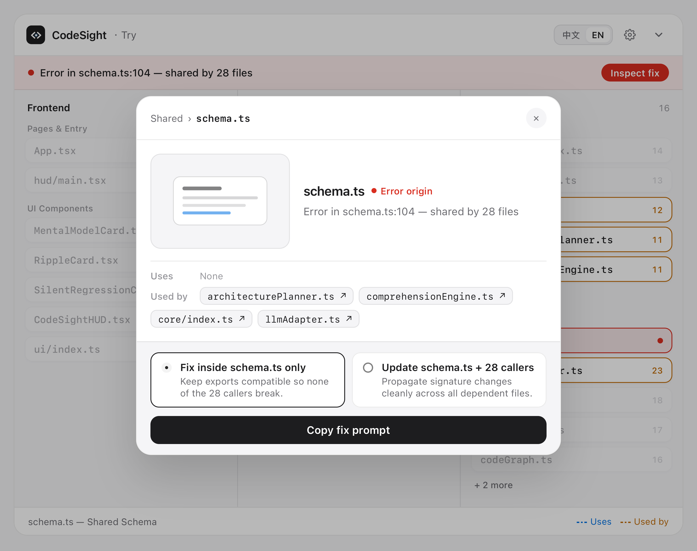
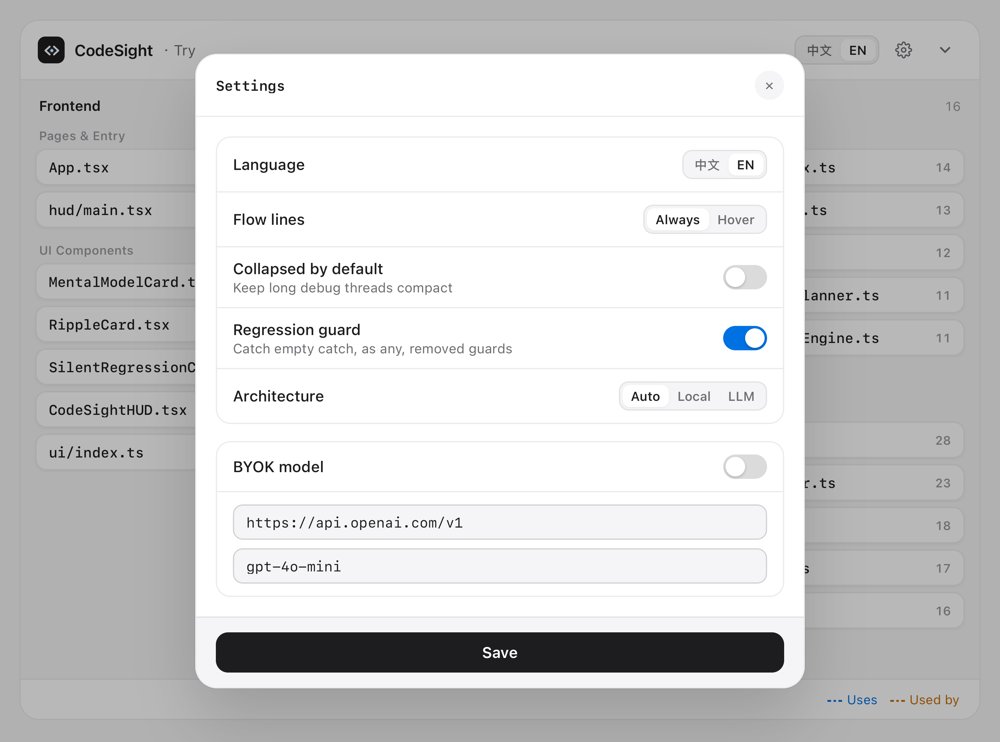
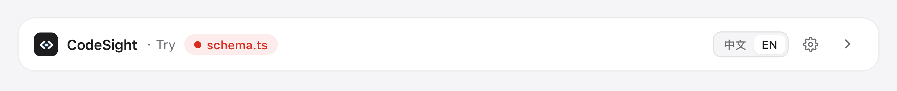

<p align="center">
  
</p>

<p align="center">
  <a href="https://github.com/Rex16200513/codesight/releases"></a>
  <a href="./LICENSE"></a>
  = 18" />
  
  
</p>

<p align="center">
  <a href="./README.md">English</a> ·
  <strong>简体中文</strong> ·
  <a href="./assets/codesight-promo.mp4">观看 1080p60 宣传视频</a> ·
  <a href="./CHANGELOG.md">更新日志</a>
</p>

---

**CodeSight** 是一款本地优先（Local-first）的 **GraphRAG 代码理解与排错引擎**，专为 AI 编程（Cursor、Claude Code、Antigravity、Codex、ChatGPT 等）设计。

当 AI 跨几十个文件改代码时，最常见的两个痛点是 **“看不清整体架构”** 和 **“静默回归”**（AI 为了让报错消失，悄悄删除鉴权校验、写空 `catch {}` 或加 `as any`）。CodeSight 在本地毫秒级构建真实 AST 调用图与依赖图，以 **0 Token 成本** 拦截静默退化，并在 AI 对话内或原生 macOS 悬浮窗中呈现极简可交互架构图。

---

## 实机演示

<p align="center">
  
</p>

<p align="center">
  <sub>1080p 60fps 完整高清宣传片：<a href="./assets/codesight-promo.mp4"><code>assets/codesight-promo.mp4</code></a></sub>
</p>

---

## 为什么选择 CodeSight

| 能力 | 直接问普通 AI Agent | 接入 CodeSight 后 |
| --- | --- | --- |
| **看懂陌生项目结构** | 逐个读文件，动辄消耗 2.5w–6w Token | 本地增量 AST + 依赖图约 25ms 完成（**0 Token**） |
| **查清改一个共用文件会影响谁** | 靠文本搜索，容易漏掉 re-export 或 JSX 组件调用 | 确定性跨文件 AST 函数/组件调用图（`codesight_trace`） |
| **定位复杂多文件报错** | 容易陷入“改 A 坏 B”死循环 | 将报错栈投影到依赖图，精准切片（**节省约 97% Token**） |
| **拦截 AI 静默回归** | 经常靠 `as any` 或空 `catch` 强行糊弄过编译 | 0-Token 静态守卫即时拦截 `REMOVED_GUARD`、`SWALLOWED_ERROR`、`TYPE_ESCAPE_HATCH` |
| **聊天流中的可读性** | 满屏冗长 Markdown 文本 | 极简可折叠交互卡：竖排分层、虚线流向、原型线框、中英即时切换 |

---

## 核心界面一览

### 1. 竖排前后端分层 + 带箭头虚线流向
自动识别 TypeScript、JavaScript 与 Python 项目的 **前端 / 后端 / 共享核心** 分层。悬停任意文件，仅拉出该文件的 **1 跳直接关联虚线**（蓝虚线为「依赖」，橙/红虚线为「影响」），清晰不缠绕。

<p align="center">
  
</p>

### 2. 点击任意模块：原型示意 + 上下游跳转
点击模块弹出毛玻璃详情页，自动推断并展示 **界面原型线框 / 服务流转图**、直接调用方数量、可点击的 `Uses ↗` / `Used by ↗` 跳转标签，以及一键生成给 AI 的精准修改/讲解指令。

<p align="center">
  
</p>

### 3. 报错影响范围 + 双选修复决策
遇到编译或运行时报错时，自动标红报错源头、拉出受影响下游虚线，并在修改高频共享文件前给出清晰的 **双选修复方向**（例如“只修内部保持接口兼容” vs “同步升级所有调用方”），把架构决策权还给开发者。

<p align="center">
  
</p>

### 4. 一键折叠 44px 单行条 + 全端统一设置
针对长对话连续排错场景设计：点击顶栏或 `⌄` 可将任意卡片收起为 **44px 极简单行条**（报错卡保留红点文件名）；点击 **`⚙`** 打开设置抽屉，所有偏好统一持久化到 `~/.codesight/config.json`，在 Agent 插件、浏览器与 macOS 悬浮 HUD 之间实时同步。

<table>
  <tr>
    <td width="52%" valign="top">
      
      <p align="center"><sub>卡片内置苹果风设置抽屉，同步至 <code>~/.codesight/config.json</code></sub></p>
    </td>
    <td width="48%" valign="middle">
      
      <p align="center"><sub>一键折叠成 44px 单行条，长对话排错清爽不刷屏</sub></p>
      <br />
      <ul>
        <li><strong>Agent 插件设置</strong>：点击卡片 <code>⚙</code> 或对话调用 <code>codesight_settings</code></li>
        <li><strong>macOS HUD 设置</strong>：按 <code>⌘,</code> 调整语言、窗口置顶、透明度与守卫开关</li>
        <li><strong>命令行设置</strong>：<code>codesight config show | set | reset</code></li>
      </ul>
    </td>
  </tr>
</table>

---

## 全生态适配矩阵

| 客户端 / 环境 | 协议通道 | 交互视图 | 一键安装命令 |
| --- | --- | --- | --- |
| **Antigravity** | 原生插件 + MCP Apps (`stdio`) | 对话内嵌交互卡 | `node packages/cli/dist/cli.js install --target antigravity` |
| **Cursor** | MCP (`stdio`) | 浏览器交互全图 + 文本 | `node packages/cli/dist/cli.js install --target cursor` |
| **Claude Code** | MCP (`stdio`) | 浏览器交互全图 + 文本 | `node packages/cli/dist/cli.js install --target claude-code` |
| **Claude Desktop** | MCP Apps (`stdio`) | 对话内嵌交互卡 | `node packages/cli/dist/cli.js install --target claude-desktop` |
| **VS Code / Copilot** | MCP (`stdio`) | 浏览器全图 + macOS HUD | `node packages/cli/dist/cli.js install --target vscode` |
| **OpenAI Codex CLI** | MCP (`stdio`) | 浏览器全图 + 文本 | `node packages/cli/dist/cli.js install --target codex` |
| **ChatGPT Apps / 远程** | Streamable HTTP (`/mcp`) | 对话内嵌 MCP Apps | `npm run mcp:http` |
| **macOS 悬浮 HUD** | 本地 Sidecar (`127.0.0.1:4317`) | 原生 SwiftUI 置顶浮窗 | `npm run hud:open` |

---

## 快速开始

```bash
git clone https://github.com/Rex16200513/codesight.git
cd codesight
npm install && npm run build
```

### 1. 一键安装到你的 AI Agent

```bash
node packages/cli/dist/cli.js install --target cursor
node packages/cli/dist/cli.js install --target claude-code
node packages/cli/dist/cli.js install --target antigravity
# 预览全部安装目标：
node packages/cli/dist/cli.js install --target all --dry-run
```

### 2. 在浏览器直接打开交互全图

```bash
# 单次静态预览
node packages/cli/dist/cli.js map --open

# 或启动本地 Sidecar（实时图谱 + 持久化设置，访问 http://127.0.0.1:4317）
npm run dev:sidecar
```

### 3. 可选：启动原生 macOS 悬浮 HUD（适合 VS Code / 传统 IDE 用户）

```bash
npm run hud:open
```

---

## 隐私与本地优先

- **默认 100% 本地运行**：AST 解析、依赖图谱、BM25/向量检索与静默回归检测均在本机完成，无需任何 API Key，不上传代码。
- **可选 BYOK 增强**：仅当你在设置中主动开启 OpenAI / DeepSeek / OpenRouter / 本地 Ollama 时，才会将剪枝后的核心切片发送给你的模型。

## 开源协议

[MIT](./LICENSE) © 2026 CodeSight Contributors
